  

# 📸 Awesome Digital Image & Asset Management 🗂️

  <strong>Curated Directory of Top Enterprise DAM Platforms, Self-Hosted Photo Libraries &amp; Real-Time Image Transformation Pipelines</strong>

  <a href="#-sector-overview--market-dynamics">Sector Overview</a> •
  <a href="#-saashosted-platforms">SaaS &amp; Hosted DAM</a> •
  <a href="#-open-source-github-projects">Open-Source DAM &amp; Photo Libraries</a> •
  <a href="#-feature-matrix--selection-guide">Selection Guide</a> •
  <a href="#-how-to-contribute">Contributing</a> •
  <a href="#-star-history">Star History</a> •
  <a href="#-support--sponsorship">Support</a>

---

## 📖 Introduction & Ecosystem Scope

Welcome to the definitive **Digital Image & Asset Management (DAM)** ecosystem resource. Whether you are an enterprise brand team looking for governed media distribution, a developer building an on-the-fly image and video transformation microservice, or a self-hoster seeking a private, end-to-end encrypted alternative to Google Photos or Apple Photos, this curated list categorizes the highest quality solutions available across proprietary SaaS and open-source software.

### 🎯 Key Focus Areas
- **🏢 Enterprise Digital Asset Management (DAM):** Brand portals, metadata governance, DRM rights management, versioning, and approval workflows.
- **🖼️ Self-Hosted Photo Libraries:** Personal and team media storage with AI face clustering, semantic CLIP search, map geocoding, and background mobile camera upload.
- **⚡ Developer Media Engines:** Real-time on-the-fly URL image transformations, WebP/AVIF auto-conversions, adaptive bitrate HLS video transcoding, and edge CDN integration.
- **🔐 Privacy & Data Sovereignty:** End-to-end encrypted (E2EE) photo backups and zero-telemetry self-hosted alternatives.

---

## 📑 Table of Contents
- [📊 Sector Overview & Market Dynamics](#-sector-overview--market-dynamics)
- [☁️ SaaS/Hosted Platforms](#️-saashosted-platforms)
- [💻 Open-Source GitHub Projects](#-open-source-github-projects)
- [🔍 Feature Matrix & Selection Guide](#-feature-matrix--selection-guide)
- [🤝 How to Contribute](#-how-to-contribute)
- [📈 Star History](#-star-history)
- [💖 Support & Sponsorship](#-support--sponsorship)
- [⚖️ Disclaimer](#️-disclaimer)

---

## 📊 Sector Overview & Market Dynamics

The global Digital Asset Management (DAM) market is estimated at **$5.4B to $6.4B in 2025–2026** and projected to surpass **$10B+ by 2030** (growing at a compound annual growth rate of ~15–18% CAGR), propelled by explosive visual content volume, omnichannel e-commerce, and generative AI automated tagging pipelines. The industry exhibits **moderate-to-high fragmentation overall**—with hundreds of specialized and self-hosted tools catering to niche vertical workflows, alongside a **highly concentrated upper tier** dominated by cloud enterprise heavyweights (e.g., Adobe, Alphabet/Google, Bynder, OpenText, Smartsheet/Brandfolder, Cloudinary) competing for unified global brand infrastructure.

---

## ☁️ SaaS/Hosted Platforms

The following hosted solutions provide turnkey infrastructure, global CDNs, enterprise security compliance (SOC 2, ISO 27001), and managed scalability:

| Product | Valuation / Revenue | Starting Pricing | Free Tier / Trial Limits | Description |
|---|---|---|---|---|
| **[Google Photos](https://photos.google.com/)** | **$2T+ Market Cap** (Alphabet / Parent Company) | $1.99 / month (or $19.99 / year for Google One 100 GB) | **Free plan**: 15 GB free lifetime storage shared across Google Photos, Gmail, and Google Drive | Consumer & prosumer photo backup with AI search, semantic natural language queries, facial recognition, and mobile sync. |
| **[Cloudinary](https://cloudinary.com/)** | **$2B Valuation** (~$100M+ ARR) | $89 / month billed annually (or $99 / month billed monthly for Plus tier) | **Free plan**: 25 monthly credits (1 credit = 1 GB storage, 1 GB net bandwidth, or 1,000 transformations), 3 user seats, 1 account | Developer-centric media optimization, real-time image/video URL transformations, responsive delivery, and digital asset management. |
| **[Bynder](https://www.bynder.com/)** | **$1.1B Valuation** (~$100M ARR; acquired by Thomas H. Lee Partners) | ~$450 / month (billed as ~$5,400 / year starting annual contract) | **No free plan**; 14-day guided proof-of-concept / demo sandbox available via sales consultation | Enterprise DAM built for brand portals, marketing team governance, AI-assisted auto-tagging, digital rights management, and 150+ martech integrations. |
| **[Brandfolder](https://brandfolder.com/)** | **$155M Acquisition** (Acquired by Smartsheet; ~$16M ARR at acquisition) | ~$500 / month (billed as ~$6,000 / year starting annual contract) | **No free plan**; 14-day proof-of-concept / sandbox access arranged through sales demo | Enterprise digital asset management featuring Brand Intelligence search, asset performance analytics, workflow routing, and unlimited guest viewers. |
| **[SmugMug](https://www.smugmug.com/)** | **~$57M–$70M Est. Revenue** (Private; parent of Flickr) | $11 / month billed annually (or $13 / month billed monthly for Basic plan) | **14-day free trial** with full Pro access; uploaded galleries remain private and customer-sharing/storefront capabilities are locked until upgraded | Photography platform with unlimited high-resolution photo/video storage, portfolio building, client proofing, and integrated print fulfillment. |
| **[Canto](https://www.canto.com/)** | **~$30M–$52M Est. Revenue** (Private; growth investment by JMI Equity) | ~$2,080 / month (typically billed as ~$25,000 / year enterprise baseline contract) | **7-day free trial** upon sales request; no permanent free tier | Mid-market and enterprise DAM providing visual search, curated brand portals, collaborative review workflows, and DRM approval management. |

---

## 💻 Open-Source GitHub Projects

Curated list of production-grade self-hosted repositories, sorted in descending order by GitHub popularity:

| Project | Star Badge | Description |
|---|---|---|
| **[Immich](https://github.com/immich-app/immich)** |  | **High-performance self-hosted backup and gallery solution designed as a direct Google Photos alternative.** Features native iOS/Android auto-backup, CLIP semantic vector search, facial recognition, partner sharing, map views, reverse geocoding, multi-user permissions, and background hardware-accelerated video transcoding (AGPL-3.0). |
| **[PhotoPrism](https://github.com/photoprism/photoprism)** |  | **AI-powered photo categorization and indexing server.** Employs Google TensorFlow for automated object, location, and facial recognition, alongside deep RAW image parsing (DNG, CR2, NEF), non-destructive metadata editing, WebDAV sync, and duplicate detection without altering folder hierarchies (AGPL-3.0). |
| **[Ente](https://github.com/ente-io/ente)** |  | **End-to-end encrypted alternative to Google Photos and Apple Photos.** Media is encrypted on-device before transmission, preventing server-side visibility. Includes mobile and desktop clients, on-device local machine learning for facial classification and semantic search, family sharing, and background sync (AGPL-3.0). |
| **[imgproxy](https://github.com/imgproxy/imgproxy)** |  | **Lightning-fast, standalone image processing and resizing microservice in Go.** Powers on-the-fly transformations, WebP/AVIF conversions, smart cropping via libvips, and secure HMAC-signed URLs for high-throughput production environments (MIT). |
| **[UnoPim](https://github.com/unopim/unopim)** |  | **Open-source Product Information Management (PIM) and Digital Asset Management (DAM) platform built on Laravel.** Designed to govern, enrich, and distribute high-volume digital assets and media catalogs across multichannel e-commerce setups (MIT). |
| **[LibrePhotos](https://github.com/LibrePhotos/librephotos)** |  | **Self-hosted photo management server with automated local AI tagging.** Delivers facial recognition, object and scene detection, location maps, timeline view, multi-user accounts, and Nextcloud integration without third-party cloud dependencies (MIT). |
| **[Photoview](https://github.com/photoview/photoview)** |  | **User-friendly, lightweight photo gallery server optimized for self-hosters and NAS hardware.** Features face recognition, RAW format handling, video playback, EXIF parsing, and multi-user isolation while navigating existing directory structures (AGPL-3.0). |
| **[Lychee](https://github.com/LycheeOrg/Lychee)** |  | **Streamlined, self-hosted photo management system.** Built on PHP and Laravel, providing elegant responsive albums, password-protected public shares, full-screen slideshows, EXIF metadata viewer, and single-click sharing (MIT). |
| **[Pimcore](https://github.com/pimcore/pimcore)** |  | **Enterprise data & experience platform unifying DAM, PIM, MDM, and CMS.** Centralizes multi-format media assets, structured metadata, automated workflow states, transcoding pipelines, and brand asset distribution for global enterprises (GPL-3.0). |
| **[Piwigo](https://github.com/Piwigo/Piwigo)** |  | **Battle-tested open-source web photo gallery application running since 2002.** Manages vast photo libraries with fine-grained access permissions, batch manager, extensive plugin catalog (350+ extensions), themes, and native iOS/Android companion apps (GPL-2.0). |
| **[Memories](https://github.com/pulsejet/memories)** |  | **Fast, modern photo and video management suite deeply integrated as a Nextcloud app.** Delivers hardware-accelerated transcoding, timeline navigation, map exploration, multi-user albums, and AI-driven facial/scene recognition with mobile client integration (AGPL-3.0). |
| **[PiGallery2](https://github.com/bpatrik/pigallery2)** |  | **Directory-first photo gallery server engineered for speed and ultra-low resource hardware.** Reads folder hierarchies directly without mandatory database lock-in, supporting ARM/Raspberry Pi hosting, map exploration, and on-demand thumbnail generation (MIT). |
| **[Photonix](https://github.com/photonixapp/photonix)** |  | **Modern web-based photo management server.** Built with Python and React, providing automated machine-learning filtering (object recognition, color analysis, face detection, location awareness) and progressive web app (PWA) responsiveness (AGPL-3.0). |
| **[Damselfly](https://github.com/Webreaper/Damselfly)** |  | **Server-based digital asset and photograph management tool designed for vast collections.** Focuses on IPTC keyword indexing, face and object recognition, lightning-fast search across hundreds of thousands of images, and folder organization (GPL-3.0). |
| **[DSpace](https://github.com/DSpace/DSpace)** |  | **Institutional repository software for archiving and managing research media, historical assets, and digital collections.** Deployed by universities, cultural organizations, and libraries worldwide for permanent digital asset governance (BSD-3-Clause). |
| **[Chevereto](https://github.com/chevereto/chevereto)** |  | **Self-hosted image and video hosting software serving as a personal Flickr or Imgur replacement.** Provides user albums, drag-and-drop uploads, external storage routing (S3, FTP), API endpoints, and community image sharing (AGPL-3.0). |
| **[Openinary](https://github.com/openinary/openinary)** |  | **Self-hostable, developer-friendly Cloudinary alternative.** On-the-fly URL transformations, automatic WebP/AVIF conversions, S3/R2 storage integration, built-in cache management, and zero-lockin Docker deployment (MIT). |
| **[ResourceSpace](https://github.com/resourcespace/resourcespace)** |  | **Enterprise-grade open-source DAM system.** Tailored for NGOs, cultural institutions, museums, and enterprise teams needing structured metadata schemas, multi-stage approval workflows, role-based governance, and brand asset management (BSD-3-Clause). |
| **[Phrasea](https://github.com/alchemy-fr/phrasea)** |  | **Production-proven DAM platform powered by Elasticsearch.** Features advanced faceted filtering, multilingual indexing, automated renditions, granular permission hierarchies, and API connectors for communication and publishing teams (MIT). |
| **[StreamKit](https://github.com/Sanskaragrawal2107/streamkit)** |  | **Self-hosted media transformation and streaming engine.** Offers real-time URL image adjustments, adaptive bitrate HLS video generation, compatibility with ImageKit/Cloudinary URL syntax, multi-cloud storage backends, and FastMCP integration (MIT). |

---

## 🔍 Feature Matrix & Selection Guide

- **Choose [Immich](https://github.com/immich-app/immich)** if you need the most seamless self-hosted Google Photos replacement with polished iOS/Android automatic background camera sync and CLIP semantic search.
- **Choose [PhotoPrism](https://github.com/photoprism/photoprism)** if you already have structured folder archives on a NAS, process RAW photography, and desire high-precision TensorFlow tagging without changing existing directory trees.
- **Choose [Ente](https://github.com/ente-io/ente)** if absolute end-to-end encryption (E2EE) and privacy are your highest operational requirements.
- **Choose [ResourceSpace](https://github.com/resourcespace/resourcespace)** or **[Phrasea](https://github.com/alchemy-fr/phrasea)** if you run a museum, charity, university, or brand requiring formal asset approval cycles, rights management, and catalog governance.
- **Choose [imgproxy](https://github.com/imgproxy/imgproxy)**, **[Openinary](https://github.com/openinary/openinary)**, or **[StreamKit](https://github.com/Sanskaragrawal2107/streamkit)** if you need high-performance microservices for dynamic image sizing and delivery to replace Cloudinary or ImageKit.

---

## 🤝 How to Contribute

Contributions are welcome and appreciated! Help keep this directory updated and comprehensive:

1. 🍴 **Fork** this repository.
2. 🌿 Create a new feature branch (`git checkout -b feature/add-new-dam`).
3. 📝 Add or edit your entry in `README.md` maintaining table formatting, pricing details, and verified badge links.
4. 🚀 Commit your improvements (`git commit -m "Add New DAM Platform"`).
5. 📬 Open a **Pull Request** detailing why the tool should be added.

---

## 📈 Star History

---

## 💖 Support & Sponsorship

Thank you for visiting and using this resource! If you find this curated directory useful for your team or personal projects, please consider:
- ⭐ **Starring** the repository on GitHub to help others discover it.
- 🍴 **Forking** and contributing new entries or updates.
- 📢 **Sharing** with fellow developers, system administrators, and brand managers.
- ☕ **Buying a coffee or sponsoring** ongoing maintenance via the [GitHub Sponsor Dashboard](https://github.com/sponsors/ishandutta2007).

---

## ⚖️ Disclaimer

- This is an independent **community-curated** list — not an official endorsement.
- All brand names, product trademarks, logos, and registered trademarks belong to their respective owners.
- Pricing, tier quotas, and feature availability reflect vendor information as of 2025–2026 and may be modified by respective providers.
